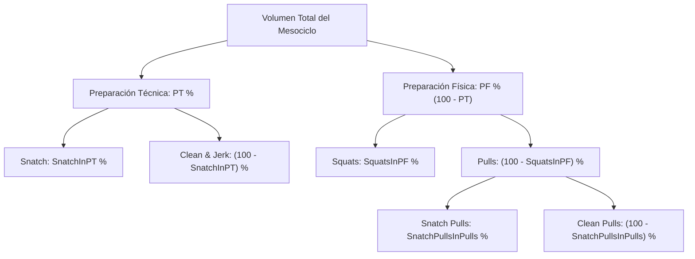

# Fundamentos Metodológicos del Método Cubano de Halterofilia

Este documento describe con rigor técnico y metodológico los principios de planificación del entrenamiento de levantamiento de pesas desarrollados por la escuela cubana de halterofilia e implementados en este software.

---

## 1. Principio Metodológico Rector

El sistema cubano de planificación de mesociclos se basa en la **regulación conjunta del volumen (cantidad de repeticiones)** y de la **intensidad media relativa (IMR)** a lo largo de microciclos sucesivos, garantizando una ondulación controlada de la carga física y técnica.

La planificación se realiza de arriba hacia abajo (*top-down*), partiendo de un volumen total asignado al mesociclo y distribuyéndolo jerárquicamente en:
1. Preparación Técnica (PT) vs Preparación Física (PF).
2. Ejercicios específicos de cada bloque.
3. Microciclos semanales según alternativas prefijadas de volumen e IMR.
4. Días de entrenamiento (Lunes a Sábado) mediante una matriz fija de distribución.
5. Zonas porcentuales de intensidad a través de tablas normadas de distribución (variantes A, B y C).

---

## 2. Rendimientos Deportivos de Referencia

A diferencia de los modelos empíricos que solicitan marcas máximas individuales en cada ejercicio (muchas veces desactualizadas o heterogéneas), la metodología cubana utiliza como único ancla metodológico el **Mejor Total Olímpico alcanzado (kg)**.

A partir del Total Olímpico ($TO$), se calculan los rendimientos de referencia teóricos para todos los ejercicios del sistema mediante coeficientes normativos:

| Ejercicio | Coeficiente | Fórmula de Rendimiento Teórico |
|---|---|---|
| **Snatch** | $0.430$ | $\text{Rendimiento} = TO \times 0.43$ |
| **Clean & Jerk** | $0.570$ | $\text{Rendimiento} = TO \times 0.57$ |
| **Squats** | $0.732$ | $\text{Rendimiento} = TO \times 0.732$ |
| **Snatch Pulls** | N/A | Utiliza como referencia el rendimiento de **Snatch** |
| **Clean Pulls** | N/A | Utiliza como referencia el rendimiento de **Clean & Jerk** |

### Justificación de los Coeficientes:
- La suma de los coeficientes de Snatch ($0.43$) y Clean & Jerk ($0.57$) suma exactamente $1.000$ ($100\%$ del Total Olímpico), reflejando la proporción antropométrica y mecánica clásica del levantador de élite.
- El coeficiente de Squats ($0.732$) establece el nivel de fuerza básica en el tren inferior requerido para soportar de manera estable las aceleraciones y posiciones de recepción del Clean y el Jerk.
- Los Pulls (Halones) se evalúan sobre la base del ejercicio competitivo correspondiente, pero trabajan en zonas porcentuales de intensidad significativamente más elevadas ($70\%$ a $115\%$), con un desplazamiento metodológico normativo de $+21$ puntos porcentuales respecto a los ejercicios clásicos.

---

## 3. Jerarquía Estricta de Porcentajes de Volumen

El volumen total del mesociclo ($V_{\text{total}}$, expresado en repeticiones enteras) se subdivide de manera estrictamente jerárquica:

### Reglas Matemáticas:
1. **Preparación Física ($PF$)**:
   $$PF = 100 - PT$$
2. **Clean & Jerk en $PT$**:
   $$\text{Clean \& Jerk}_{\%PT} = 100 - \text{Snatch}_{\%PT}$$
3. **Pulls en $PF$**:
   $$\text{Pulls}_{\%PF} = 100 - \text{Squats}_{\%PF}$$
4. **Clean Pulls en Pulls**:
   $$\text{Clean Pulls}_{\%Pulls} = 100 - \text{Snatch Pulls}_{\%Pulls}$$

### Cálculo del volumen nominal por ejercicio:
$$\text{Reps}_{\text{Snatch}} = V_{\text{total}} \times \left(\frac{PT}{100}\right) \times \left(\frac{\text{Snatch}_{\%PT}}{100}\right)$$
$$\text{Reps}_{\text{Clean \& Jerk}} = V_{\text{total}} \times \left(\frac{PT}{100}\right) \times \left(\frac{100 - \text{Snatch}_{\%PT}}{100}\right)$$
$$\text{Reps}_{\text{Squats}} = V_{\text{total}} \times \left(\frac{100 - PT}{100}\right) \times \left(\frac{\text{Squats}_{\%PF}}{100}\right)$$
$$\text{Reps}_{\text{Snatch Pulls}} = V_{\text{total}} \times \left(\frac{100 - PT}{100}\right) \times \left(\frac{100 - \text{Squats}_{\%PF}}{100}\right) \times \left(\frac{\text{Snatch Pulls}_{\%Pulls}}{100}\right)$$
$$\text{Reps}_{\text{Clean Pulls}} = V_{\text{total}} \times \left(\frac{100 - PT}{100}\right) \times \left(\frac{100 - \text{Squats}_{\%PF}}{100}\right) \times \left(\frac{100 - \text{Snatch Pulls}_{\%Pulls}}{100}\right)$$

> [!IMPORTANT]
> **Nunca** se deben calcular los porcentajes internos directamente sobre el volumen total sin respetar la cadena de multiplicación jerárquica.

---

## 4. Alternativas de Microciclos y Desplazamientos de IMR

La duración del mesociclo puede fijarse en 2, 3, 4 o 5 microciclos (semanas). Cada duración dispone de un conjunto de **Alternativas oficiales** extraídas de la metodología original cubana.

Cada alternativa define:
1. El porcentaje de volumen que corresponde a cada microciclo ($\sum \% = 100\%$).
2. El vector de **desplazamientos de IMR** ($\Delta \text{IMR}_i$), expresado en puntos porcentuales enteros.

### Regla Fundamental de los Desplazamientos
La IMR objetivo de cada microciclo $i$ se calcula como:
$$\text{IMR}_i^{\text{teórica}} = \text{IMR}_{\text{mesociclo}} + \Delta \text{IMR}_i$$

> [!WARNING]
> Los desplazamientos originales de cada alternativa son obligatorios e inalterables. Bajo ningún concepto se deben modificar artificialmente los desplazamientos metodológicos para forzar que el promedio ponderado coincida exactamente con la IMR objetivo del mesociclo. El sistema calcula la IMR real obtenida y expone la desviación resultante con total transparencia técnica.

### Tabla Oficial de Alternativas Cubanas:

#### Mesociclo de 2 Microciclos
| Alt. | Distribución de Volumen (%) | Desplazamientos de IMR ($\Delta$) | Tipo de Dinámica |
|---|---|---|---|
| **1** | 60% — 40% | 0 — +1 | Descendente en volumen / Ascendente en intensidad |
| **2** | 45% — 55% | -1 — +1 | Ascendente en volumen / Ascendente en intensidad |
| **3** | 50% — 50% | -1 — +1 | Estable en volumen / Ascendente en intensidad |

#### Mesociclo de 3 Microciclos
| Alt. | Distribución de Volumen (%) | Desplazamientos de IMR ($\Delta$) | Tipo de Dinámica |
|---|---|---|---|
| **1** | 35% — 40% — 25% | -1 — +1 — 0 | Carga concentrada en micro 2 |
| **2** | 30% — 40% — 30% | -1 — 0 — +1 | Progresión escalonada de IMR |
| **3** | 33% — 34% — 33% | -1 — 0 — +1 | Volumen uniforme / Incremento de IMR |

#### Mesociclo de 4 Microciclos
| Alt. | Distribución de Volumen (%) | Desplazamientos de IMR ($\Delta$) | Tipo de Dinámica |
|---|---|---|---|
| **1** | 28% — 30% — 22% — 20% | -2 — -1 — +1 — +2 | Clásica piramidal (acumulación y descarga) |
| **2** | 25% — 32% — 23% — 20% | -2 — -1 — +1 — +2 | Pico de volumen en micro 2 |
| **3** | 22% — 28% — 30% — 20% | -2 — -1 — +1 — +3 | Pico de volumen en micro 3 |
| **4** | 20% — 25% — 30% — 25% | -2 — -1 — +1 — +2 | Creciente hasta micro 3 |

#### Mesociclo de 5 Microciclos
| Alt. | Distribución de Volumen (%) | Desplazamientos de IMR ($\Delta$) | Tipo de Dinámica |
|---|---|---|---|
| **1** | 18% — 24% — 26% — 20% — 12% | -2 — -1 — 0 — +1 — +2 | Campana clásica de 5 semanas |
| **2** | 20% — 22% — 25% — 20% — 13% | -2 — -1 — +1 — +1 — +2 | Acumulación sostenida |
| **3** | 15% — 20% — 25% — 25% — 15% | -3 — -2 — 0 — +1 — +3 | Ondulación amplia |

---

## 5. Distribución Diaria Obligatoria (Lunes a Sábado)

El método cubano establece una programación de seis días semanales (descanso dominical). La proporción de cada ejercicio asignada a cada día de la semana es **fija y no editable**, respondiendo a la ondulación de las cargas intra-semanales y la compatibilidad neuromuscular entre ejercicios:

| Ejercicio | Lunes | Martes | Miércoles | Jueves | Viernes | Sábado | Suma |
|---|---:|---:|---:|---:|---:|---:|---:|
| **Snatch** | 25% | 15% | 20% | 8% | 22% | 10% | **100%** |
| **Clean & Jerk** | 27% | 18% | 20% | 10% | 25% | 0% | **100%** |
| **Squats** | 25% | 15% | 20% | 10% | 23% | 7% | **100%** |
| **Snatch Pulls** | 0% | 45% | 0% | 55% | 0% | 0% | **100%** |
| **Clean Pulls** | 50% | 0% | 0% | 0% | 50% | 0% | **100%** |

### Reglas Metodológicas de la Matriz Diaria:
1. **Días Cero Inviolables**: Días con $0\%$ de asignación (p. ej., Clean & Jerk los sábados; Snatch Pulls los lunes, miércoles, viernes y sábados) **jamás deben recibir repeticiones** por efectos de redondeo o ajuste.
2. **Consistencia Inter-Microciclos**: La misma proporción estructural se aplica en todos los microciclos del mesociclo.
3. **Distribución de Halones**: Los Snatch Pulls se concentran en Martes (45%) y Jueves (55%), mientras que los Clean Pulls se concentran en Lunes (50%) y Viernes (50%).

---

## 6. Tablas de Zonas de Intensidad y Selección de Variantes A/B/C

Para cada valor de IMR y para cada familia de ejercicios existen tres variantes oficiales de distribución porcentual: **Variante A, Variante B y Variante C**.

### Familias de Tablas:
1. **Ejercicios Clásicos y Squats**:
   - Rango de IMR: $45\%$ a $80\%$.
   - Zonas de Intensidad: $50\%, 60\%, 65\%, 70\%, 75\%, 80\%, 85\%, 90\%, 95\%$.
   - Total de entradas: 108 distribuciones (36 valores de IMR $\times$ 3 variantes).
2. **Pulls (Snatch Pulls y Clean Pulls)**:
   - Rango de IMR: $65\%$ a $100\%$.
   - Zonas de Intensidad: $70\%, 80\%, 85\%, 90\%, 95\%, 100\%, 105\%, 110\%, 115\%$.
   - Desplazamiento metodológico: $+21$ puntos respecto a la IMR clásica ($\text{IMR}_{\text{pulls}} = \text{IMR}_{\text{clásica}} + 21$).
   - Total de entradas: 108 distribuciones (36 valores de IMR $\times$ 3 variantes).

### Selección Automática y Determinista de la Variante:
Para cada microciclo y ejercicio, el motor de optimización evalúa las tres variantes ($A, B, C$) correspondientes a la IMR objetivo.

La variante seleccionada es aquella cuya distribución discreta minimiza la desviación cuadrática respecto a la IMR teórica:
$$\text{Variante Óptima} = \arg\min_{v \in \{A, B, C\}} \left| \text{IMR}_{\text{real}}(v) - \text{IMR}_{\text{teórica}} \right|$$

En caso de empate matemático en el error absoluto, se aplica la regla de desempate determinista establecida: orden alfabético prioritario ($A \succ B \succ C$).
